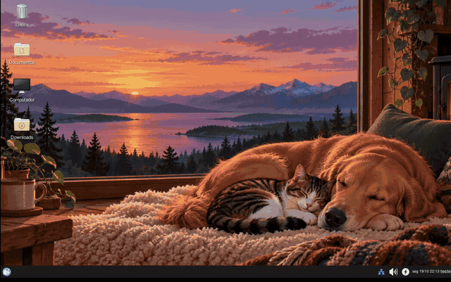

# PDTI Revive

### Uma nova vida para computadores antigos.

**Distribuição Linux baseada no Debian 13 (Trixie), com Xfce, aplicativos acessíveis e otimização inteligente para diferentes perfis de hardware.**

  
  
  
  

[Visão geral](#visão-geral) · [PDTI Store](#pdti-store--central-própria-de-aplicativos) · [AutoTune](#autotune--otimização-inteligente) · [Edições](#edições) · [Demonstração](#demonstração-animada) · [Capturas](#capturas-de-tela) · [Status](#status-do-projeto)

Prévia da área de trabalho • clique na imagem para ampliar

---

## Visão geral

O **PDTI Revive** é um projeto de distribuição Linux voltado a tornar o uso do computador mais simples, mesmo em máquinas com recursos limitados. Combina a base do **Debian 13**, o ambiente gráfico **Xfce** e ferramentas desenvolvidas para facilitar a instalação de aplicativos e o ajuste do sistema.

O desenvolvimento prioriza **leveza, manutenção prática e uma experiência familiar**. As duas ISOs da revisão **0.3.1 R7 (Lite e Standard) foram compiladas**, conforme confirmação do mantenedor. O projeto continua em homologação: estas imagens ainda não são anunciadas aqui como lançamentos públicos.

## Principais recursos

| Recurso | O que oferece |
| :--- | :--- |
| **PDTI Store** | Catálogo organizado por categorias, busca, detalhes de aplicativos e ações de instalação ou remoção. |
| **APT + Flatpak** | Acesso a programas dos repositórios Debian e suporte a aplicativos externos via Flathub. |
| **Ícones de aplicativos** | Identificação visual com cache offline e atualização automática dos metadados AppStream do Flathub na R7. |
| **AutoTune** | Detecta características do hardware e ajusta o perfil de otimização do sistema. |
| **Desktop Xfce** | Interface tradicional e personalizável, adequada ao objetivo de manter o sistema leve. |
| **BIOS e UEFI** | Imagens híbridas preparadas para diferentes modos de inicialização. |

## PDTI Store — central própria de aplicativos

A **PDTI Store** é a loja desenvolvida para o PDTI Revive. Em vez de depender do terminal para encontrar e instalar programas, o usuário encontra uma interface gráfica organizada, integrada ao Debian 13.

A versão **0.3.1-7** utiliza o catálogo online assinado **v103, com 68 aplicativos**, incluindo **Arduino IDE 2** e **Tor Browser**, e apresenta informações para ajudar o usuário a escolher programas compatíveis com o computador.

**O que ela oferece:**

- **Explorar e pesquisar:** navegação por categorias como internet, escritório, multimídia, design e utilitários.
- **Identificação visual:** **45 ícones disponíveis offline** no pacote e busca dinâmica por ícones de aplicativos APT e Flatpak. Na **R7**, a loja atualiza os metadados AppStream do Flathub em segundo plano, com controle de intervalo, e recarrega os ícones disponíveis; sem conexão prévia, alguns ícones ainda podem usar a imagem genérica.
- **Disponibilidade pelo APT:** consulta se um pacote está disponível ou instalado nos repositórios configurados do Debian.
- **Instalar e remover:** operações de gerenciamento de pacotes integradas ao APT; em testes na VM, o **Geany foi instalado e desinstalado com sucesso**.
- **Aplicativos externos:** suporte ao **Flatpak/Flathub** como opção complementar. A origem do aplicativo é indicada, inclusive quando o pacote é distribuído por terceiros.
- **Página de detalhes:** descrição, origem, identificador, versão instalada/disponível, tamanho quando conhecido e informações de compatibilidade.
- **Aplicativos instalados:** uma aba que reúne programas detectados no sistema e exibe versão, origem e tamanho quando disponíveis.
- **Configurações:** controles de integração com Flatpak e de catálogo remoto, com **verificação de assinatura Ed25519** antes de aceitar atualizações.

### Catálogo online e atualização dos aplicativos

O catálogo da PDTI Store pode ser atualizado **sem recompilar as ISOs**. O administrador utiliza o **PDTI Store Manager** para cadastrar e publicar novas entradas em um catálogo JSON assinado digitalmente; a loja verifica a assinatura Ed25519 antes de aplicá-lo. Isso atualiza a **lista de aplicativos disponíveis**, não os binários dos programas ou o sistema operacional.

- [Catálogo online v103](catalog/catalog.json) e [assinatura](catalog/catalog.json.sig): **68 aplicativos**, incluindo **Arduino IDE 2** (`cc.arduino.IDE2`) e **Tor Browser Launcher** (`org.torproject.torbrowser-launcher`), oferecidos pelo Flatpak.
- **R7 — ícones dinâmicos:** resolução de ícones e atualização dos metadados AppStream automaticamente ao abrir a loja, quando o Flathub e a rede estão disponíveis, sem travar a interface; a atualização respeita um intervalo entre tentativas.
- **Modo Live CD:** o mantenedor confirmou que os novos ícones carregaram automaticamente em teste com internet, sem executar comandos manuais.
- **Sem internet:** a loja mantém os ícones incorporados e os caches já disponíveis; ícones ainda não obtidos podem aparecer como genéricos.

A sincronização do **catálogo de aplicativos** continua disponível pelas configurações da loja; a atualização automática do **AppStream** é um recurso distinto.

### Escolha de aplicativos de acordo com o hardware

A loja apresenta indicações de consumo, como **leve** e **moderado**, levando em conta o foco da distribuição em PCs antigos. Programas que pedem mais recursos recebem avisos, mas a decisão de instalar continua com o usuário.

  
  
Catálogo da PDTI Store em teste — aplicativos reconhecidos com ícones e indicação de disponibilidade.

> **Estado atual:** as funcionalidades APT e a interface foram exercitadas em máquina virtual. O **Flathub automático em instalação limpa** foi validado nas revisões anteriores, e a **atualização automática de ícones no modo Live CD da R7** foi confirmada pelo mantenedor. Ainda são necessários testes de instalação limpa específicos da R7 nas duas edições; a presença de um aplicativo no catálogo não garante sua disponibilidade em todas as arquiteturas.

## AutoTune — otimização inteligente

O **PDTI Revive AutoTune** é o componente que adapta os ajustes do sistema ao computador. Seu objetivo é **priorizar fluidez e uso consciente de memória**, sobretudo em equipamentos antigos, sem exigir que o usuário conheça cada configuração do Linux.

### Como funciona

**1. Identifica o hardware.** A interface apresenta dados como processador, quantidade de memória RAM, tipo de armazenamento e características gráficas.

**2. Seleciona um perfil.** O AutoTune usa as informações detectadas para recomendar ou aplicar um perfil de otimização. A interface permite visualizar o **modo automático** e o **modo manual**, além de exibir a pontuação calculada para o equipamento.

**3. Mostra o que foi ajustado.** Em vez de esconder as alterações, a central lista as otimizações ativas e os avisos pertinentes.

**4. Oferece controle ao usuário.** A interface inclui a opção de restaurar configurações originais. Algumas alterações, especialmente relacionadas à memória de troca, podem exigir reinicialização.

### Exemplo real de teste

Em uma máquina virtual de teste com aproximadamente **2 GB de RAM** e armazenamento identificado como **HDD**, o AutoTune selecionou o **perfil Econômico** e apresentou as seguintes otimizações:

| Área | Ajuste mostrado no teste | Objetivo |
| :--- | :--- | :--- |
| Interface | Compositor e efeitos visuais desativados | Reduzir trabalho gráfico e consumo de memória |
| Memória | ZRAM configurada com compressão **zstd** | Ajudar a aproveitar melhor a RAM disponível |
| Disco | Ajustes no despejo de páginas de memória modificadas | Melhorar o comportamento de escrita em disco lento |
| Arquivos | Limite para miniaturas locais | Reduzir trabalho adicional no gerenciador de arquivos |
| Proteção | Regra para RAM crítica | Evitar um perfil inadequado quando há pouca memória |

  
  
AutoTune em funcionamento na VM, com hardware identificado, perfil ativo e explicação dos ajustes.

> **Importante:** o AutoTune não aumenta a capacidade física do computador nem garante ganhos de velocidade em qualquer cenário. O efeito de cada ajuste depende do hardware e dos programas utilizados. O comportamento das regras ainda faz parte dos testes de homologação.

## Edições

| **Lite** | **Standard** |
| :--- | :--- |
| Pensada para computadores modestos e uso com menos recursos. | Pensada para quem busca uma experiência mais completa no uso diário. |
| Prioriza economia de memória e fluidez. | Reúne mais recursos e aplicativos. |
| Compartilha a PDTI Store e o AutoTune. | Compartilha a PDTI Store e o AutoTune. |

> A compatibilidade e o desempenho dependem do hardware. Os requisitos mínimos definitivos serão publicados após os testes de homologação.

## Demonstração animada

Veja o **PDTI Revive em funcionamento**, incluindo a área de trabalho, a PDTI Store e o AutoTune.

  

  
Demonstração real do sistema em desenvolvimento.

## Capturas de tela

As imagens abaixo são de testes da **PDTI Revive 0.3.1** em máquina virtual. Clique em cada uma para visualizar em tamanho maior.

<table>
  <tr>
    <td align="center" width="50%">
       
      <strong>PDTI Store · Explorar aplicativos</strong>
    </td>
    <td align="center" width="50%">
       
      <strong>PDTI Store · Aplicativos instalados</strong>
    </td>
  </tr>
  <tr>
    <td align="center" colspan="2">
       
      <strong>AutoTune · Otimização conforme o hardware</strong>
    </td>
  </tr>
</table>

Capturas demonstrativas. O papel de parede e marcas de aplicativos podem estar sujeitos a direitos de terceiros.

## Status do projeto

**Versão em teste: 0.3.1 R7 · PDTI Store 0.3.1-7 · catálogo v103 (68 aplicativos)**

| Marco | Situação |
| :--- | :--- |
| Compilação das ISOs R7 Lite e Standard | **Concluída (confirmada pelo mantenedor)** |
| Teste Live CD da R7 e carregamento automático dos ícones | **Confirmado pelo mantenedor** (edição testada não especificada) |
| PDTI Store 0.3.1-7 e catálogo v103 | **Preparados** — 68 aplicativos |
| Testes de instalação limpa Lite e Standard de revisões anteriores | **Confirmados** |
| Instalação limpa de ambas as edições R7 | **Ainda não confirmada** |
| Integração Flatpak/Flathub em instalação limpa anterior | **Validada** |
| Hashes SHA-256 das ISOs R7 | **Aguardando conferência e registro público** |
| Testes adicionais da loja e do AutoTune em VM | Em andamento |
| Revisão das licenças dos ícones e homologação geral | Pendente |

As imagens e o pacote da loja foram arquivados com verificações de integridade. **Ainda não há um download público homologado neste repositório.**

<strong>Ver hashes SHA-256 de referência da R5 (artefatos anteriores)</strong>

| Artefato | SHA-256 |
| :--- | :--- |
| `pdti-store_0.3.1-5_all.deb` | `d23d28a6499f6936736a8c1023a81edfcb8a6d83bfce7933836b63703df6fd0c` |
| `pdti-revive-lite-amd64-0.3.1-final.iso` | `a8a1fe52f8eba3b2f39c77dbfe1cddc554dc04956103888151ef724db6a69fb3` |
| `pdti-revive-standard-amd64-0.3.1-final.iso` | `6c6c30b274a429cb4484d8755bfdb20fd38fc02b5b78cf1685f606361c02e238` |

Os hashes acima são **da revisão R5**, não das ISOs R7. Os hashes R7 serão adicionados após verificação. Hashes verificam a integridade dos arquivos; não representam homologação funcional nem assinatura criptográfica de release.

## Próximas etapas

- [x] Finalizar testes limpos das edições **Lite** e **Standard**.
- [x] Validar o **Flathub no primeiro acesso** sem configuração manual (teste confirmado pelo mantenedor em versão anterior).
- [x] Compilar as ISOs **R7 Lite e Standard** (conclusão confirmada pelo mantenedor).
- [x] Validar no **Live CD R7** o carregamento automático dos ícones do Flathub (teste confirmado pelo mantenedor).
- [ ] Concluir os testes de instalação limpa da **R7 nas duas edições**, incluindo o comportamento offline.
- [ ] Conferir e publicar os hashes SHA-256 dos artefatos **R7**.
- [ ] Revisar as licenças dos ícones e outros recursos incorporados.
- [ ] Publicar o código-fonte, os testes e os scripts de build após auditoria.
- [ ] Preparar as primeiras **Releases** públicas acompanhadas de instruções e checksums.

## Desenvolvimento e documentação

O repositório está sendo estruturado de forma gradual. Consulte o [histórico de alterações](CHANGELOG.md) e a [galeria de imagens](docs/imagens/ORIGEM.md).

As ISOs, discos virtuais e diretórios temporários de compilação ficam fora do histórico Git; o objetivo é manter o repositório dedicado ao código-fonte e à documentação.

## Licenciamento

A licença geral do código ainda não foi definida. Ícones, marcas, temas e outros componentes de terceiros obedecem às suas respectivas licenças. Materiais pendentes de revisão não serão oferecidos como redistribuição pública.

---

**PDTI Revive** · Desenvolvido e mantido por [Yagami-Murakami](https://github.com/Yagami-Murakami)

*Tecnologia acessível. Mais possibilidades para o hardware que você já tem.*

